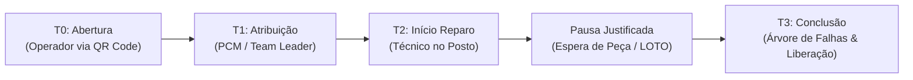

# CMMS FAETERJ • Sistema de Gestão de Manutenção Fabril

> **Trabalho de Conclusão de Curso (TCC)**  
> **Curso:** Análise e Desenvolvimento de Sistemas (ADS)  
> **Instituição:** FAETERJ Barra Mansa  
> **Autor:** Iury Lopes  
> **Referência Operacional:** Chão de fábrica do Polo Automotivo Stellantis / Paraman  

---

## 🏭 Visão Geral do Projeto

O **CMMS FAETERJ** é uma plataforma full-stack moderna projetada para sanar os principais gargalos operacionais da manutenção industrial em linhas automatizadas de produção (Chaparia, Pintura e Montagem Final):
- **Comunicação verbal lenta e repasse deficiente** entre operadores e equipe de manutenção.
- **Distorção no cálculo de MTTR** decorrente da falta de múltiplos marcos temporais ($T_0$ a $T_3$), que mistura tempo de fila com tempo real de reparo.
- **Oscilação de conectividade em galpões industriais** (gaiolas de Faraday causadas por telhados metálicos e maquinário pesado).
- **Descontrole e atrasos no consumo de sobressalentes**, solucionado com a arquitetura de **Reserva Pendente**.

---

## 📐 Os 4 Marcos Temporais de Engenharia ($T_0 \to T_3$)

Para garantir fidelidade matemática aos indicadores de confiabilidade (World Class Manufacturing - WCM e TPM), o sistema segrega estritamente o ciclo de vida da Ordem de Serviço:



### Fórmulas Matemáticas Implementadas
- **MTTR Líquido Puro (Mean Time To Repair):**
  $$\text{MTTR} = \frac{\sum (T_3 - T_2 - \sum \text{pausas})}{N_{\text{falhas}}}$$
- **MTTA (Mean Time to Acknowledge):**
  $$\text{MTTA} = \frac{\sum (T_1 - T_0)}{N_{\text{chamados}}}$$
- **MTBF (Mean Time Between Failures):**
  $$\text{MTBF} = \frac{\text{Horas Nominais de Operação}}{N_{\text{falhas}}}$$
- **Disponibilidade Operacional Inerente ($A$):**
  $$A = \frac{\text{MTBF}}{\text{MTBF} + \text{MTTR}} \times 100\%$$

---

## 🛠️ Módulos Integrados do Sistema

1. **Terminal do Operador (Fricção Zero / PWA)**:
   - Abertura de chamado em 2 toques através da leitura de QR Code físico na máquina.
   - Identificação simplificada por crachá/RE sem necessidade de senha.
   - Cache offline inteligente para garantir abertura mesmo sem sinal Wi-Fi no galpão.
2. **Cockpit de Manutenção & Team Leader (Desktop / IHM)**:
   - Monitoramento em tempo real via WebSockets (Socket.io).
   - Tickers progressivos de downtime em segundos por máquina parada.
   - Alarme sonoro tipo torre industrial implementado nativamente via Web Audio API (880 Hz / 660 Hz).
   - Matriz de priorização GUT (Gravidade, Urgência e Tendência).
3. **Terminal do Mantenedor em Campo (Mobile)**:
   - Registro de chegada ao posto e acionamento do cronômetro ($T_2$).
   - Gestão de pausas operacionais que suspendem o MTTR.
   - Requisição de peças sobressalentes em modo reserva pendente.
   - Encerramento técnico ($T_3$) com categorização por Árvore de Falhas (Mecânica, Pneumática, Elétrica, Automação).
4. **Painel do Almoxarifado (Estoque & Sobressalentes)**:
   - Fila unificada de requisições pendentes de peças em campo.
   - Confirmação de baixa física que decrementa o saldo em tempo real.
   - Monitoramento de saldo mínimo com alertas críticos de reposição.
5. **Motor de Indicadores & Métricas Industriais (Analytics)**:
   - Consolidação de KPIs de disponibilidade e confiabilidade.
   - Diagrama de Pareto 80/20 automatizado por subsistema.
   - Ranking dos Top 5 Ofensores de downtime da fábrica.

---

## 💻 Stack Tecnológica

### Backend
- **Node.js** com **Express**
- **Knex.js** (Query Builder e Migrations versionadas)
- **MySQL 8.0**
- **Socket.io** (Barramento bidirecional em tempo real)
- **JWT (JSON Web Token)** e **Bcrypt** para autenticação e RBAC

### Frontend
- **React** com **Vite**
- **Tailwind CSS v4**
- **Lucide Icons**
- **React Router DOM**
- **Web Audio API** para alarmes industriais nativos

---

## 🚀 Como Executar Localmente

### 1. Pré-requisitos
- Node.js 18+ instalado
- MySQL 8.0 ativo na porta local `3306`

### 2. Configurar e Iniciar o Backend
```bash
cd backend
npm install

# Executar migrations e seeds com dados reais de fábrica
npx knex migrate:latest
npx knex seed:run

# Rodar a suíte completa de testes de integração (18 testes)
npm test

# Rodar a simulação E2E de turno de fábrica (12 etapas)
node tests/e2e-scenario.test.js

# Iniciar servidor backend na porta 3001
npm start
```

### 3. Configurar e Iniciar o Frontend
```bash
cd frontend
npm install

# Testar compilação do build
npm run build

# Iniciar servidor de desenvolvimento Vite (porta 5173)
npm run dev
```

Abra o navegador em `http://localhost:5173`.

---

## 🧪 Usuários e Credenciais de Demonstração (Seed)

| Perfil | Matrícula (RE) | Senha Padrão | Responsabilidade |
|---|---|---|---|
| **Gestor PCM** | `RE-1042` | `cmms123` | Despacho de OS, Matriz GUT e Cockpit em Tempo Real |
| **Team Leader** | `RE-2105` | `cmms123` | Acompanhamento da Linha MV3 e Homologação |
| **Mantenedor** | `RE-3088` | `cmms123` | Atendimento em campo, cronômetro T2, pausas e T3 |
| **Almoxarife** | `RE-4015` | `cmms123` | Baixa de peças e controle de saldo sobressalente |
| **Operador** | `RE-5001` | *Fricção Zero* | Leitura de QR Code e reporte de anomalia no maquinário |
| **Administrador**| `RE-0001` | `cmms123` | Acesso pleno a todas as rotas e relatórios |

---

## 📚 Documentação Adicional
- Dicionário de Dados e Diagrama Entidade-Relacionamento (DER): `Segundo Cerebro/conhecimento/wiki/tcc-cmms-dicionario-de-dados-e-der.md`
- Design System e Ergonomia Cognitiva (NBR 7195 / ISO 3864): `Segundo Cerebro/conhecimento/wiki/tcc-cmms-design-system-e-ergonomia.md`
- Metodologia e Roteiro de Validação Prática: `Segundo Cerebro/conhecimento/wiki/tcc-cmms-metodologia-e-roteiro-de-validacao.md`

---

*FAETERJ Barra Mansa • Trabalho de Conclusão de Curso • Autor: Iury Lopes*